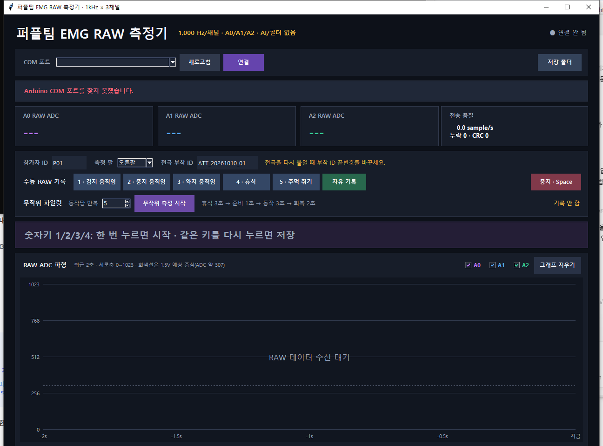
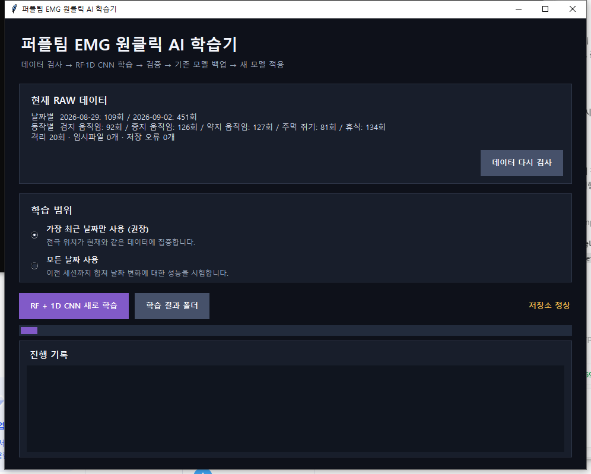
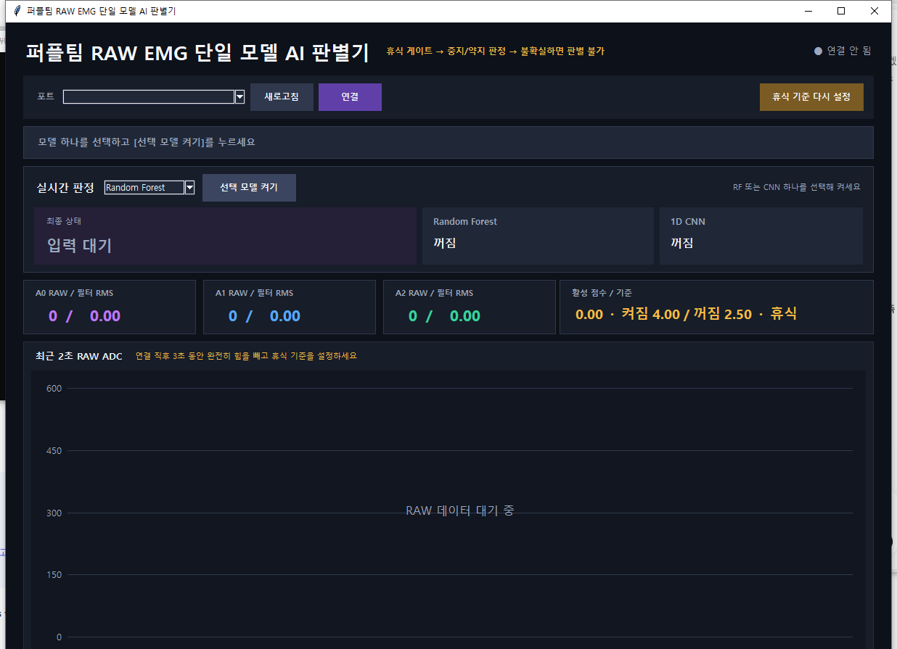

# Purple EMG Toolkit

3채널 표면 근전도 신호를 1 kHz로 기록하고, Random Forest와 1D CNN을 학습해 휴식·검지·중지·약지·주먹 상태를 판별하는 공개 연구용 소프트웨어입니다.

이 저장소에는 측정 GUI, 버튼식 학습 GUI, 실시간 판별 GUI, Arduino 데이터 송신 펌웨어, 학습에 사용한 원자료와 최종 모델이 포함됩니다. 장갑과 모터 같은 기계 하드웨어 설계는 포함하지 않습니다.

## 주요 기능

- 3채널 10 bit ADC 원자료 수신
- 500,000 baud, 14 byte binary packet, CRC-16/CCITT-FALSE 검사
- BIN·CSV·JSON 회차별 저장과 sample index 누락 검출
- 20~450 Hz 대역 처리와 60 Hz 계열 잡음 억제
- 휴식 gate와 세션별 휴식 RMS 보정
- 67개 특징 기반 Random Forest
- 3×1,000 원파형 기반 1D CNN
- 회차 단위 학습·검증·시험 분리
- 저장소 사전검사, 학습 잠금, 모델 백업과 안전한 교체

## 실행 화면

### RAW 측정기



### 원클릭 AI 학습기



### 실시간 AI 판별기



## 저장소 구성

```text
apps/                    측정기와 실시간 판별기 GUI
EMG_AI/                  데이터 검사, 학습 GUI, RF/CNN 학습 코드와 모델
firmware/                Arduino Uno용 3채널 RAW 송신 펌웨어
raw_records/             공개된 전체 측정 원자료
scripts/                 Windows 실행 도우미
tests/                   패킷 파서와 전처리 기본 검사
DATASET.md               데이터 구조와 해석 범위
MODEL_CARD.md            모델 성능과 한계
```

## 설치

Python 3.11 이상을 권장합니다. Windows에서는 Tkinter가 포함된 공식 Python 배포판을 사용하세요.

```powershell
python -m venv .venv
.\.venv\Scripts\Activate.ps1
python -m pip install --upgrade pip
python -m pip install -r requirements.txt
```

PyTorch 설치가 환경에 따라 실패하면 [PyTorch 공식 설치 안내](https://pytorch.org/get-started/locally/)에서 CPU 또는 CUDA 환경에 맞는 명령을 사용한 뒤 나머지 의존성을 설치하세요.

## 실행

저장소 루트에서 실행합니다.

```powershell
python apps\PurpleTeam_EMG_RAW_Recorder.py
python EMG_AI\PurpleTeam_EMG_OneClick_Trainer.py
python apps\PurpleTeam_EMG_AI_Classifier.py
```

Windows에서는 `scripts` 폴더의 배치 파일을 실행해도 됩니다.

### 측정 순서

1. `firmware/SEN0240_3ch_raw_binary.ino`를 Arduino Uno에 업로드합니다.
2. A0, A1, A2 입력과 COM 포트를 확인합니다.
3. RAW 측정기를 실행하고 참가자 ID, 측정 팔, 전극 부착 ID를 입력합니다.
4. 동작 레이블을 고른 뒤 회차별로 저장합니다.
5. 생성된 BIN·CSV·JSON은 `raw_records/YYYY-MM-DD`에 저장됩니다.

### 학습 순서

1. 버튼식 학습기를 실행합니다.
2. 최신 날짜 또는 전체 날짜 범위를 선택합니다.
3. 저장소 검사 후 RF와 CNN 학습을 시작합니다.
4. 검증과 더미 추론을 통과한 모델만 활성 모델 폴더로 교체됩니다.

### 실시간 판별

실시간 판별기와 RAW 측정기는 같은 COM 포트를 동시에 사용할 수 없습니다. 판별기를 연결한 뒤 약 3초 동안 힘을 빼고 휴식 기준을 측정하세요. 전극을 다시 붙였거나 접촉 상태가 바뀌면 반드시 재보정해야 합니다.

## 공개 모델 결과

전체 날짜 유효 자료 522회를 회차 단위로 나눈 시험에서 다음 결과를 얻었습니다.

| 모델 | 시험 정확도 | macro F1 |
| --- | ---: | ---: |
| Random Forest | 76.9% | 0.787 |
| 1D CNN | 86.5% | 0.872 |

이 수치는 한 사용자의 제한된 날짜와 회차에서 얻은 결과입니다. 새로운 사용자, 완전한 전극 재부착, 다른 피부 상태나 팔 자세에 대한 일반화 성능을 의미하지 않습니다. 자세한 내용은 [MODEL_CARD.md](MODEL_CARD.md)를 확인하세요.

## 안전 및 사용 제한

이 프로젝트는 연구·교육용이며 의료기기 또는 인증된 산업 안전장치가 아닙니다. 분류 결과를 사람에게 힘을 가하는 장치에 연결하려면 별도의 장력 제한, 기계식 스토퍼, 비상정지, 통신 중단 시 이완, 반복 내구성 검증이 필요합니다.

## 데이터와 라이선스

소스 코드, 저장소의 데이터와 배포된 모델은 Apache License 2.0으로 공개합니다. 외부 라이브러리는 각 라이브러리의 라이선스를 따릅니다.

## 인용

연구나 프로젝트에서 사용할 경우 저장소 이름과 GitHub URL을 명시해 주세요.

